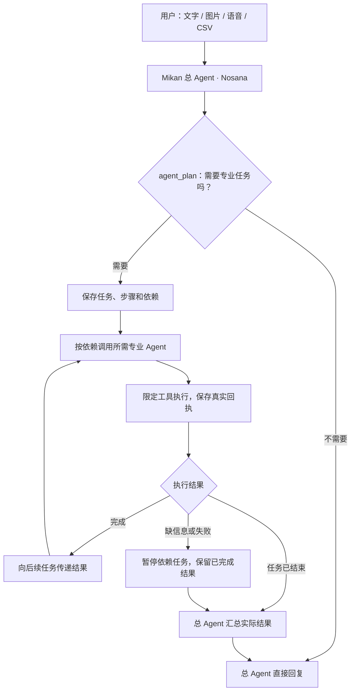

# Mikan BOT：总 Agent 与专业 Agent

本次参考 `/Users/cr/Desktop/teamflow-yt` 的实际 BOT 实现。复用了架构思路，没有引入其其他云服务、账号系统或 API。

| 参考项目                                             | Mikan 实现                           | 相同的职责                                                            |
| ---------------------------------------------------- | ------------------------------------ | --------------------------------------------------------------------- |
| `integrations/opendots/server/chat-runner.ts`        | `src/lib/farm/coordinator.ts`        | 总 BOT 先规划，再根据执行结果回复                                     |
| `integrations/opendots/server/specialist-runtime.ts` | `coordinator.ts`、`agent-runtime.ts` | `agent_plan` / `agent_delegate`、最多六项专业任务、依赖顺序、实际回执 |
| `lib/agent-specialists.ts`                           | `src/lib/farm/specialists.ts`        | 每个专业 Agent 只能使用分配给自己的工具                               |

总 Agent 本身只有规划与委派工具，不能直接确认订单、启用发货规则或改变箱子发货状态。普通聊天可以生成空计划，只显示总 Agent；不会固定把六个专业 Agent 都调用一遍。

| 专业 Agent | 限定工具与平台                                                       |
| ---------- | -------------------------------------------------------------------- |
| 接待       | Nosana 回复及附件解析；Tavily 查询气象、物流公开公告                 |
| 订单       | Nosana 提取订单；数据库去重、保存草稿；提出当天已装箱发货规则        |
| 生产安排   | Nosana 分析库存与任务；数据库创建已确认订单的作业邀请                |
| 配送协调   | Daytona 执行 Python 排程；数据库检查装箱状态、分批同意和同日到达条件 |
| 进度监督   | 数据库检查超时、负责人、交接凭据；后台定时监测仍独立运行             |
| 工具适配   | CodeAF 在 Daytona 中用 Nosana 编写转换器，验证 CSV，再保存草稿       |

专业 Agent 也是独立的 Nosana 工具调用循环。它先读取最新农场事实，再执行自己的限定任务。上游结果由服务器传递，不依赖模型凭空回忆。计划只能依赖前面的任务；未知 Agent、重复任务标识、超过六项的计划会被拒绝。工具参数经过 Zod 验证，重复调用复用当前执行结果。缺信息或失败时停止当前专业任务，依赖它的任务不会启动。总 Agent 可通过 `agent_delegate` 补充必要工作，但不能绕过等待状态或重复已完成的同一任务。

## 数据与执行模式是两回事

| 数据     | 执行模式         | 行为                                                    |
| -------- | ---------------- | ------------------------------------------------------- |
| 实际农场 | 真实 API（默认） | 总 Agent 和专业 Agent 使用 Nosana，按需调用另外三家平台 |
| 模拟农场 | 真实 API（默认） | 同一套总 Agent、工具与 API，只操作独立的模拟数据库      |
| 模拟农场 | 明确选择离线验证 | 固定样例响应和本机 Python；每项标记为离线/模拟          |

在原来的 AI 助手中选择「実 API を使用」或「オフライン検証」。没有额外模拟页面或侧边栏入口。执行模式写入每项后台任务，切换不会改变已提交的任务；旧版本已入队的样例任务仍按原来的离线方式处理。真实 API 失败不会自动回退成模拟成功。

对话显示总 Agent 的选择理由、任务步骤、依赖、执行状态、各 Agent 的彩色头像及工具回执。计划中的 Agent 不等于已经调用：等待前置条件的任务只显示在计划里，不生成执行头像记录。

## 一单蜜柑验证规则

农户说「今天只发已经装好的箱子」，总 Agent 通常委派订单 Agent 生成规则草稿，再让配送 Agent 检查边界。是否分批由农户确认，客户同意和同日到达要求单独保存；未确认的规则不能发货。当前只实现这一种有明确边界的规则，不是任意规则代码生成器。

示例订单是两个 5 kg 箱：第一箱已装好，第二箱未装好。有明确分批同意且无同日到达要求时只发第一箱；否则等待。规则按日本日期失效，重复点击不重复发货。真实 API 模式也不会把模拟发货变成真实物流下单。

## 运行边界

- SQLite、后台 Worker、附件、订单确认、库存预留等仍由本应用实现；未复制参考项目的 Convex、Inngest、第三方集成或账号服务。
- 只允许 Nosana、Tavily、Daytona、CodeAF。总 Agent 的 Nosana 模型需要支持函数工具调用。
- 未配置可用的 `NOSANA_MODEL` 时，真实总 Agent 会报告未配置，不会声称完成了语义调度。
- 专业 Agent 不具备订单确认、规则启用、实际发货或发送客户消息的工具；仍使用现有人工确认流程。
- 当前提供请求内的依赖执行和保存回执。后台中断不自动重试付费调用；尚未复制参考项目完整的跨请求 `agent_continue` 恢复和权限系统。
